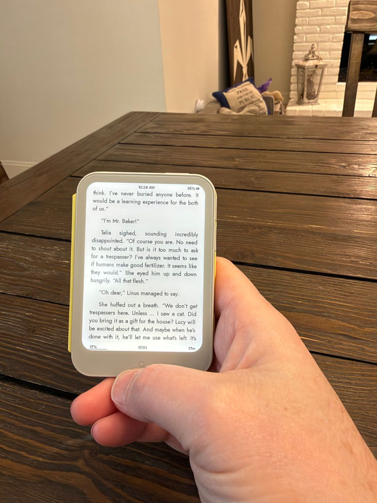
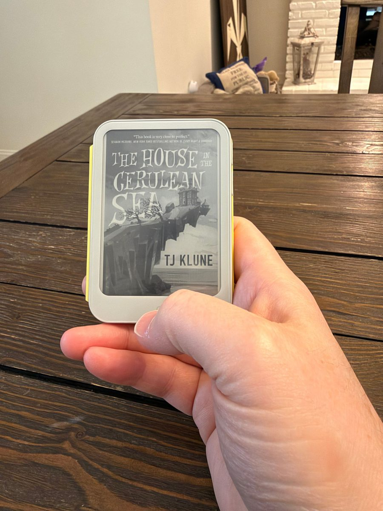
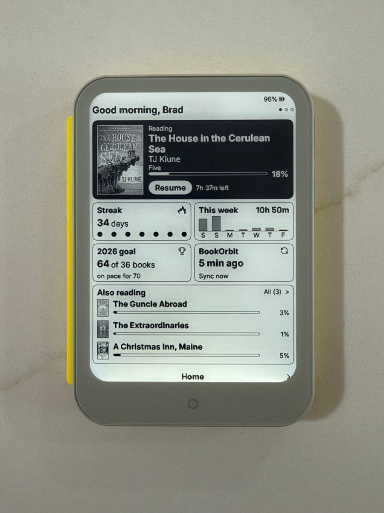
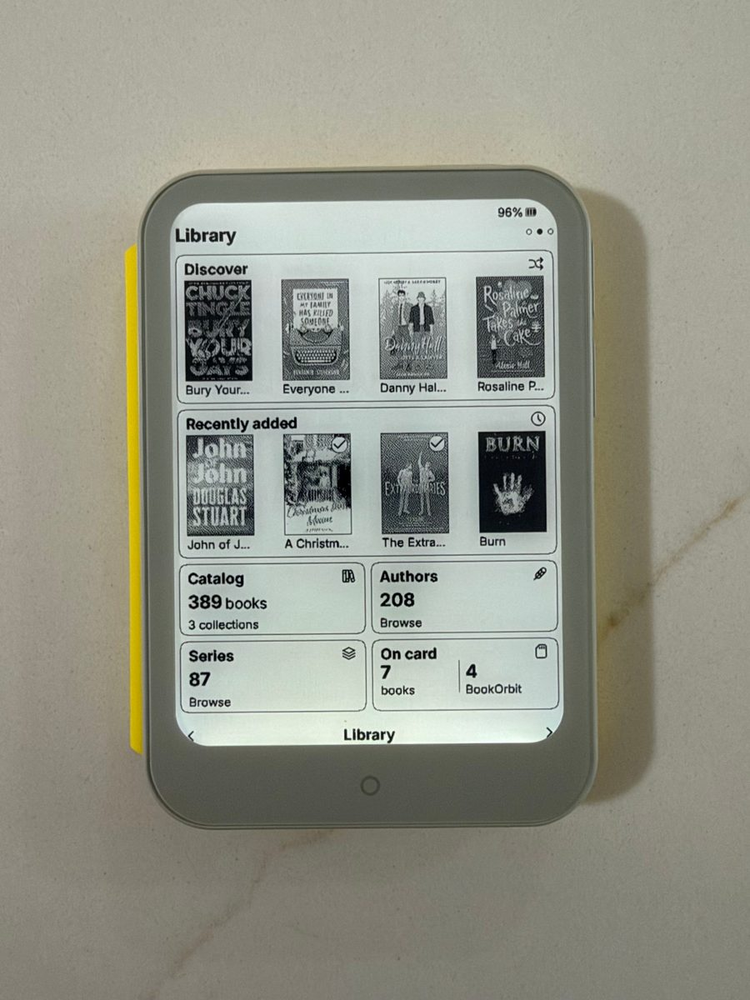
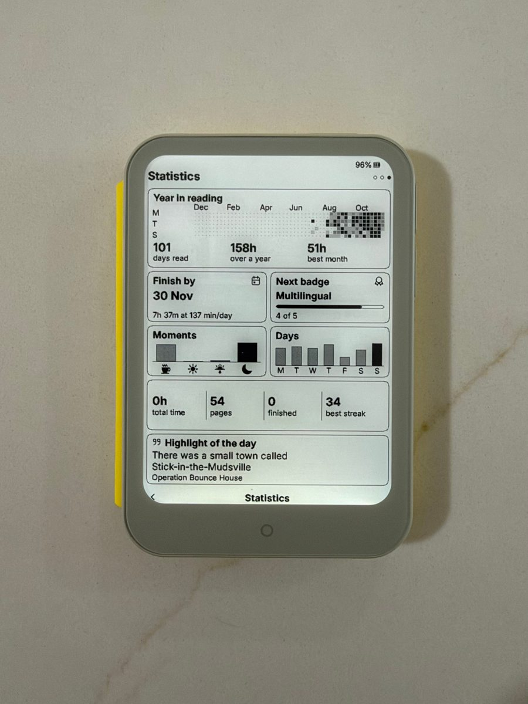

# CrossInk + BookOrbit for the EEGO Reader A4

Firmware for the **EEGOREAD A4** and **A4 Lite** e-readers that syncs with a self-hosted [BookOrbit](https://github.com/bookorbit/bookorbit) library: reading progress, highlights and bookmarks in both directions, reading statistics, and a catalog for browsing and downloading your books on the device.

> [!WARNING]
> **Unofficial firmware, use at your own risk.** It is not made, endorsed or supported by EEGO/EEGOREAD, CrossPoint, CrossInk, CrossInk-Bookorbit or BookOrbit, and it has been tested on very few devices. Flashing replaces the stock firmware and may void your warranty. Read the warning in the [install guide](docs/eego-a4-install.md) and back up the stock firmware before you flash.

**[Install it on an EEGO A4](docs/eego-a4-install.md)** · [Releases](https://github.com/thebradbishop/CrossInk-Bookorbit/releases) · [Changelog](CHANGELOG.md)

<p align="center">
  
  
</p>

## What it is built on

1. **[CrossPoint](https://github.com/crosspoint-reader/crosspoint-reader)**: open-source firmware for ESP32 micro e-readers. The A4's stock firmware is itself a rebranded CrossPoint.
2. **[CrossInk](https://github.com/uxjulia/CrossInk)**: a CrossPoint fork with more themes, fonts and reader features. Its v2.0.0 added official EEGO A4 support.
3. **[CrossInk-Bookorbit](https://github.com/agosez/CrossInk-Bookorbit)**: a CrossInk fork that adds the BookOrbit integration described below. This repository is a fork of it, based on its `v2.0.0+bookorbit.1`.
4. **[FreeInk SDK](https://github.com/Free-Ink/freeink-sdk)**: the hardware layer, including the A4's display, touch, battery and frontlight drivers.

All the A4 hardware support comes from those projects. Fonts, themes, reader features, reading stats, controls and the web server are CrossInk's: see the [upstream README](https://github.com/uxjulia/CrossInk#readme) and the [docs](./docs/) folder.

## What this fork adds

- **Apply to All Books**: font and layout changes made inside a book become the default for every book, instead of being kept for that book only. It is on by default, in the reader's font settings and the font menu inside a book.
- **BookOrbit Sync on Wake**: waking the reader syncs the book you were reading before it reopens. Choose Every Wake, After 15 Min or After 1 Hour (skip the sync when the book synced more recently than that). See [Syncing when the device wakes](#syncing-when-the-device-wakes).
- **A sync banner**: a sync shows its progress as a banner in the middle of the screen you were on, instead of switching to screens of its own, and returns to your book by itself. It joins a saved Wi-Fi network directly.
- **BookOrbit boot logo**: the boot screen shows BookOrbit's icon with "Powered by CrossInk" underneath. Switch it off under **Settings → System → BookOrbit Sync → BookOrbit Boot Logo**.
- **Faster SD-card fonts**: glyphs for fonts on the SD card are read in batches (from [CrossPoint #4601](https://github.com/crosspoint-reader/crosspoint-reader/pull/4601)).
- **Updates from this repository**: Check for Updates looks at this repository's releases, so an update cannot replace this firmware with one that lacks these features.

## What it inherits from CrossInk-Bookorbit

- **BookOrbit progress sync**: sync your reading position with a self-hosted BookOrbit server.
- **BookOrbit highlight and bookmark sync**: two-way. What you highlight or bookmark on the device appears in the web reader at its exact place in the text, what you add on the web lands in the book, and deletions propagate both ways.
- **A BookOrbit Home theme**: Home as pages of tiles modeled on BookOrbit's dashboard.
- **BookOrbit catalog browser**: browse your server's library on the device and download EPUBs over Wi-Fi, including by author, series or collection.
- **Offline shortcuts to your own books**: "On device" and "In progress" categories that open a book directly, without touching the network.
- **Reading statistics pushed to BookOrbit**: your reading time, streaks and pace on the server's dashboard, fed by the pages you turn on the device.
- **KOReader Sync is removed**: CrossInk-Bookorbit drops CrossInk's KOReader sync (renamed Sync Server in CrossInk v2.0.0) in favour of BookOrbit. Credentials already saved on the SD card are left alone.

BookOrbit exposes a KOReader-compatible sync API, so this firmware talks to it the same way the official BookOrbit KOReader plugin does. Your BookOrbit server must be recent enough to serve the KOReader plugin endpoints under `{server}/api/v1/koreader` — including `plugin/catalog/*` for the catalog browser and `plugin/annotations/*` / `plugin/bookmarks/*` for highlight and bookmark sync (servers without those are detected, and the missing steps are simply skipped).

---

## The BookOrbit Home theme

<p align="center">
  
  
  
</p>

Choose **BookOrbit** in **Settings → Display → UI Theme**, and Home becomes three pages of tiles modeled on BookOrbit's own dashboard:

- **Home** — the current book with its chapter, progress and time left (Confirm resumes it), your streak, this week's reading, your yearly goal, the BookOrbit tile that refreshes everything, and the other books you are reading, on this device or another one.
- **Library** — the catalog's Discover and Recently Added shelves, links to the catalog, its authors and its series, and what is on the card: how many books, how many came from BookOrbit, and how full the card is. A book that is not on the card yet downloads from its cover, and Home comes back once it is done.
- **Statistics** — a year of reading, one square a day, when you will finish the current book, the times and days you read, your all-time totals, the next badge and a highlight of the day.

On the A4, swipe between pages and tap a tile; the page buttons turn pages. Opening Home never waits on the network: Sync on Sleep or the BookOrbit tile bring the server's numbers, reading done on the device counts straight away, and without an account the theme runs on your own numbers. The [reader features guide](docs/reader-features.md#bookorbit-home) has the details.

---

## Setting up your BookOrbit account

### On your BookOrbit server

The device signs in with your account's **KOReader sync credentials**, not your BookOrbit web login. Create them once, in **Settings → Devices & Sync → KOReader**, with **Create credentials** — each BookOrbit account has a single set, shared by all of its readers. Once they exist, the page's **Setup** panel shows the **Sync server URL**:


That URL is what the device asks for below. The preconfigured plugin offered on the same page is for actual KOReader devices — CrossInk needs only the URL and the credentials.

### On the device

1. Go to **Settings → System → BookOrbit Sync**.
2. Fill in **Username** and **Password** — the KOReader sync credentials created above — and **Server URL**, the Sync server URL shown on the same page. The URL accepts a bare hostname (`books.example.com`); `https://` is assumed, and a pasted `/api/v1` or `/api/v1/koreader` suffix is stripped for you.
3. Choose **Authenticate**. The device connects to WiFi and validates the credentials against your server. You should see _Successfully authenticated!_

Credentials live on the SD card in `/.crosspoint/bookorbit.json`, obfuscated with the device's hardware MAC — the same scheme CrossInk uses for KOReader credentials.

### Behind Cloudflare Access

If your server is published through a Cloudflare tunnel with an Access policy in front of it, Cloudflare stops the device's requests before they reach BookOrbit. Give the device a [service token](https://developers.cloudflare.com/cloudflare-one/access-controls/service-credentials/service-tokens/) to let it through:

1. In Cloudflare Zero Trust, create a service token and allow it on your BookOrbit application with a policy whose action is **Service Auth**.
2. On the device, start **File Transfer** and open `http://<device-ip>/settings` in a browser.
3. Under **BookOrbit Sync**, fill in **Cloudflare Access Client ID** and **Cloudflare Access Client Secret**, then save. The secret is never shown back; emptying the Client ID removes the token from the device.

The device then presents the token with every BookOrbit request, as the `CF-Access-Client-Id` and `CF-Access-Client-Secret` headers. It does so only when the server URL is `https://`.

> Give the reader a service token of its own, allowed on BookOrbit only. Its secret is kept on the SD card the way your password is — obfuscated, not encrypted — and the device does not verify the server's certificate. A token that opens nothing else can be revoked without touching the rest of your setup.

## Syncing reading progress

Open a book, then **Menu → Bookmarks tab → BookOrbit Sync**. The device compares the position stored on the server with your local one — chapter, page, percentage and the device name that last uploaded — and offers two choices:

- **Apply remote progress** — jump to the position from your other reader.
- **Upload local progress** — publish your current position to the server.

The option matching the furthest-read position is preselected. If the server has no progress for the book yet, you are offered a straight upload.

### Smart sync

**Settings → System → BookOrbit Sync → Sync Behavior** chooses what a sync does with that screen. **Ask every time**, the default, always shows it. **Smart sync** resolves the clear cases on its own and only asks when asking is genuinely useful:

- If the server is further ahead _and_ has moved since this device last synced the book, the server position is applied and you are back in the book.
- If your local position is further ahead _and_ the server has not moved since this device last synced, your position is uploaded — the screen flashes "Upload successful" and returns on its own.
- Equal positions just say "Already synced" and return.

Anything else still shows the choice screen: the first sync of a book on a device, a server that reports no dates, and above all a genuine conflict — both sides having moved since your last sync, which is exactly the case a human should arbitrate.

A newer date on the server is not enough to say it has moved, because BookOrbit's web reader saves the position a book opens at: opening the book there and closing it gives the server's position a new date without anyone having read a page. What the web reader saves is the start of its own page, so a server position found in the chapter your device last synced in, at or before the page it synced, counts as not having moved, and your further position is still uploaded. A server position further on means someone read elsewhere. One in an earlier chapter means someone went back on purpose, which is also how BookOrbit hands out a progress reset, and it is never overwritten without asking.

Each device remembers its last sync of each book (the server's date and the position both sides were left at) in a small file next to the book's cache, and every sync updates it whichever mode is active, so the history smart sync relies on is already in place when you enable it. A book last synced with v1.6.1+bookorbit.1 or earlier has the date only, and goes by it until its next sync settles the progress.

BookOrbit identifies books by the binary partial-MD5 hash of the EPUB file (the same "Binary" matching KOReader offers), so the **same EPUB file** has to be present on both readers for positions to pair up. A book downloaded from your BookOrbit catalog is the exact file your server knows about, so it matches automatically.

### Syncing without opening the menu

**Settings → Controls** lets you bind _BookOrbit Sync_ to the power button (short or long press) or to a long press on Menu or Back. The action also works outside the reader: it syncs the book you last had open, or opens the BookOrbit settings if no account is configured yet.

### Syncing when the device goes to sleep

Turn on **Settings → System → BookOrbit Sync → Sync on Sleep** and the device syncs the book you last had open every time it goes to sleep, whether from the power button, the sleep timer or a Quick Lock timeout. The sleep screen goes up first. The device then joins a saved Wi-Fi network (the last one used first, then any other saved network in range), runs a full sync behind that screen, draws the sleep screen again and finishes going to sleep. Nothing else is shown. The second refresh is there because the sleep screen loses some contrast while the sync runs behind it; a Quick Resume screen comes back in plain black and white, without the smoothed text the reader draws.

- **Waking the device cancels the sync.** Press Power the way you would to wake it. The sync stops at its next step and the device wakes as usual. Whatever the sync had already sent is kept, and the rest follows on the next sync.
- **Progress follows the Smart sync rules**, whatever **Sync Behavior** says, because nobody is there to answer the choice screen. When those rules cannot decide (the first sync of a book on this device, or both sides having moved), progress is left alone for your next manual sync. Highlights, bookmarks and reading sessions sync either way.
- **It is skipped** when no book is open, when no Wi-Fi network is saved, and when the battery is below 10% with no charger connected.

Each sync keeps Wi-Fi on for a few seconds, and longer when no saved network answers, so the option is off by default.

### Syncing when the device wakes

**Settings → System → BookOrbit Sync → Sync on Wake** syncs the book you were reading when a press of the power button wakes the device and it is about to reopen that book. The sync runs before the book is loaded, as a banner over the sleep screen, and the book opens as soon as it is done.

- **Every Wake** syncs each time. **After 15 Min** and **After 1 Hour** skip the sync when the book finished a sync (from the menu, on sleep or on wake) more recently than that, so a quick look at the reader does not wait on Wi-Fi.
- **Progress follows the Smart sync rules**, whatever **Sync Behavior** says. A genuine conflict (both sides moved since the last sync) still shows the choice screen, since you are there to answer it.
- **It is skipped** when no Wi-Fi network is saved, and when the battery is below 10% with no charger connected. A sync that fails shows the error for two seconds and opens the book anyway.

Expect a few seconds per wake, mostly joining Wi-Fi and the secure connection to your server. The option is off by default.

### The sync banner

A sync shows its progress (joining Wi-Fi, highlights, bookmarks, reading sessions, then the position) in a banner in the middle of the screen it started from, and goes back to the book by itself once it is done. The screen is saved to the SD card while the reader restarts into its network mode, so the banner sits over the page you were on. Only the choices take the whole screen: a progress conflict, no progress on the server yet, and a newer copy of the book in your library.

## Syncing highlights and bookmarks

Every BookOrbit sync of a book also exchanges its highlights and bookmarks with the
server, in both directions:

- **Highlights** made on the device appear in BookOrbit's web reader at their exact
  position in the text, with the book's exact wording; highlights created in the web
  reader come down and are drawn in the book. Deleting one on either side removes it
  from the other at the next sync.
- **Bookmarks** work the same way: a page bookmarked on the device shows up in the web
  reader, and a bookmark placed on the web lands in the book — on the right page when
  the device has already read that chapter, at the chapter start otherwise, refined the
  first time you jump to it.

Nothing to enable: if an account is configured, both ride along with every sync, and
the sync screen reports what each exchange did: highlights received from the server
and sent to it, each counted as added and deleted ("Received: 1 added, 0 removed"). Book matching is the same binary hash as progress sync, so the same EPUB
file has to be on both sides.

Details worth knowing:

- Highlights travel 8 per request — this hardware bounds what fits beside an open TLS
  connection — and a sync sends as many requests as the backlog needs, both ways: one
  sync sends every new highlight and brings down every one added on the web.
- Highlights and bookmarks made before this feature existed gain their sync identity
  progressively as you read, one chapter per visit, and start syncing from there.
- A highlight's stored text is capped at 4 KB; an extremely long web highlight is drawn
  up to where that cap cuts its text.
- The device draws every highlight the same way. Notes, colors and styles added on the
  web stay on the server, and a highlight that came from the server is never sent back.
- BookOrbit 3.5.0 tracks highlights per book file rather than per device, so after the
  server is upgraded, the first sync of each book receives back every highlight it
  already had. They are recognized and nothing is duplicated.
- With BookOrbit 3.5.0 or later, a book that lost all its highlights or bookmarks on the
  device (a wiped card, say) gets them back from the server at its next sync.

## Reading statistics

Every BookOrbit sync of a book also uploads the reading it has recorded since the last
one: one event per page you read, with when you started it and how long you stayed on it.
That is what the official BookOrbit KOReader plugin sends too, so the server's reading
time, streaks, pace and reading-DNA views fill in the same way. It is one-way — BookOrbit
has no API to read stats back — so the device's own Reading Stats screens are unaffected
and keep working offline.

Nothing to enable: if an account is configured, the events ride along with each sync. They
are queued per book on the SD card in the meantime, so nothing is lost if you read offline
for a week.

### How faithful the timestamps are

The A4 has a clock chip (a PCF8563), so every page event is stamped with the real time and lands where it belongs. Syncing regularly (Sync on Sleep, Sync on Wake or the BookOrbit Sync shortcut) keeps the server's streaks and daily charts current.

## Browsing and downloading from the catalog

Reach the catalog from **Settings → System → BookOrbit Sync → Browse Catalog**, or from the **BookOrbit** entry in the home menu (it appears once an account is configured).

The root list contains:

| Entry                                         | What it shows                                                                                                                                       |
| --------------------------------------------- | --------------------------------------------------------------------------------------------------------------------------------------------------- |
| Recently added / Continue reading / All books | Your server's own sections                                                                                                                          |
| **Authors** / **Series**                      | Paged lists with a book count per entry; pick one to see its books (series are listed in series order)                                              |
| **Collections**                               | Your server's collections, with a book count per entry; pick one to see its books                                                                   |
| **Want to Read**                              | The books you most recently marked as want to read, when your server offers that shelf                                                             |
| **Search**                                    | Free-text search of your library                                                                                                                    |
| **On device**                                 | Everything downloaded from the catalog, wherever it was filed, plus every EPUB in the download folder, the SD card root and `/Read` — works offline |
| **In progress**                               | Recent books you haven't finished yet — works offline                                                                                               |

In a server book list, **Confirm** downloads the book into the download folder configured in the BookOrbit settings (the SD card root by default). A download that gets interrupted resumes automatically on retry, and **Back** cancels it. Books already present on the device are marked with a dot at the end of the line, so you can tell at a glance what is worth downloading.

The file is named by **your server's KOReader file naming template** — BookOrbit's _Settings → Koreader → File Naming_, the same template its own KOReader plugin follows — so a book can land inside a series folder, for instance. BookOrbit resolves the template and tells the device where the file belongs; a per-device override set on the server is honoured too, and any folder it asks for is created under your download folder. If your account has no template, BookOrbit's default applies, which files books under `Series/` and `Standalone/`. Books downloaded before this behaviur existed are left where they are.

A book that reached the card some other way, sent by another app or copied over USB, has no dot even when it sits exactly where the template files it: only a book's details say where that is. Confirm finds it there, and when the file has the size of your library's, opens it instead of downloading it again and marks it from then on.

A server book list (a root section, the books of an author, series, collection, library or SmartScope, or search results) can be sorted and filtered, as the Library is sorted:

- **Sort** — date added, title, author (by last name), recently read or series. The first row of the picker flips the direction (A-Z or Z-A); a newly picked order starts in its natural direction, newest first for dates.
- **Filter** — all books, or only those that are unread, being read or finished on your BookOrbit account. The header then names the filter, and its count is the number of matching books.

On the A4, the two buttons at the right of the header open them. Your server does the sorting and filtering, so a long list keeps paging exactly. The choice applies to the list you are in; opening a section again shows it in its own order.

When the Library's **List View** is **Expanded**, a book list is split into sections the way the Library splits its own: by first letter when sorted by title or author (where your server ranks it, by the author's last name), by day when sorted by date added, and by series when sorted by series. The second row of the Sort picker switches the List View between Expanded and Compact without leaving the catalog; it is the Library's setting, so the Library follows.

**Want to Read** lists the books you most recently marked as want to read in BookOrbit: the shelf BookOrbit's own KOReader plugin shows, a dozen books at most, in the order you marked them. It appears after the server's sections when your server offers that shelf. BookOrbit's catalog cannot filter a whole list by that status, so it is a shelf rather than a filter choice.

In **On device** and **In progress**, Confirm opens the book in the reader instead of downloading it. **On device** is sorted by file name on the SD card and read a page at a time, so it lists every book, however many the card holds.

A long listing keeps only the pages around the one on screen in memory and reloads the others from the SD card as you scroll back.

> If the catalog reports _"BookOrbit sent an unexpected reply"_, the server answered but not with the catalog API — usually a BookOrbit version without the KOReader catalog endpoints, a wrong server URL, or a reverse proxy/SSO layer intercepting `/api/v1/koreader/plugin/*`.

---

## Installation

Follow **[Installing on the EEGO Reader A4](docs/eego-a4-install.md)**: back up the stock firmware, then flash the four files from this repository's [releases](https://github.com/thebradbishop/CrossInk-Bookorbit/releases) over USB-C with esptool. The guide also covers going back to the stock firmware.

Once this firmware is installed, **Settings → System → Check for Updates** looks at this repository's releases, so later versions can arrive over the air.

### Languages

Since CrossInk v2.0.0 only English is built into the firmware. CrossInk-Bookorbit publishes its own language packs, translated in full including the BookOrbit screens: choose **Settings → System → Device → Download Languages**, connect to Wi-Fi and pick a language, and the reader installs it and restarts to Home. After updating from an earlier version, What's New offers to download the language you were using. Without Wi-Fi, take `crossink-languages-<version>.zip` from the same release as the firmware, copy its `.crossink` folder to the root of the SD card, then pick the language in **Settings → System → Device → Language**. Upstream CrossInk's packs do not fit: they lack the BookOrbit screens. The settings this fork adds (Sync on Wake, BookOrbit Boot Logo, Apply to All Books) stay in English in other languages.

## Development

```sh
pio run -e eego_a4 --target upload   # EEGO A4 build, flashed over USB-C; see platformio.ini for the other devices
```

See [Getting Started](./docs/development/getting-started.md) for prerequisites and validation commands, and [Testing and Debugging](./docs/development/testing-debugging.md) for serial logging and static analysis. `AGENTS.md` holds the repository's engineering conventions.

## Documentation

- [User Guide](./docs/user-guide.md) and [Reader Features](./docs/reader-features.md)
- [Controls](./docs/controls.md) — full button action list
- [Installing on the EEGO Reader A4](./docs/eego-a4-install.md), and CrossInk's general [Installation](./docs/installation.md)
- [Data Cache](./docs/data-cache.md) and [File Formats](./docs/file-formats.md)
- [Common issues](./docs/troubleshooting.md)
